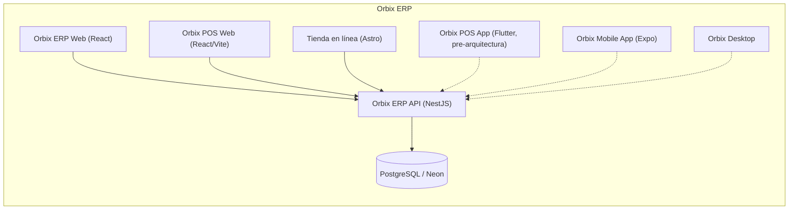

# Orbix — Knowledge Vault

Base de conocimiento de **Orbix ERP** (repo `orbix-admin`, GitHub `Orbix-MX/POS-Admin`):
POS/ERP multi-tenant y multi-vertical — retail, restaurante, gimnasio y servicios.

Está escrita para dos tipos de lector: **personas** que necesitan entender *qué hace* el
producto y *qué sistema lo soporta*, y **agentes de IA** que necesitan contexto antes de
tocar código.

> Regla del vault: aquí no se documenta código. Se documenta **conocimiento**: procesos,
> reglas, responsabilidades, límites y decisiones. Lo que no pudo inferirse del código
> aparece marcado explícitamente como **Requiere validación**.

---

## Por dónde empezar

| Si eres… | Empieza por |
|---|---|
| Nuevo en el negocio | [[Glosario]] |
| Nuevo en el código de Orbix ERP | [[Arquitectura general]] → [[Orbix ERP API]] |
| IA / agente | [[Arquitectura general]] + el `README.md`/`CLAUDE.md` del proyecto objetivo |

---

## Mapa del ecosistema

---

## Procesos de negocio

- [[Ventas y Punto de Venta (Orbix)]]
- [[Inventario y Compras (Orbix)]]
- [[Modelo de producto por vertical (Orbix)]] — simple, receta, combo y variantes
- [[Tienda en Linea (Orbix)]] — storefront y pedidos por WhatsApp
- [[Cuentas por Cobrar y Pagar (Orbix)]]
- [[Restaurante (Orbix)]]
- [[Servicios y Ordenes de Trabajo (Orbix)]]
- [[Administracion Multi-tenant (Orbix)]]

## Sistemas

Cada sistema tiene un documento con su nombre (qué es, de qué responde) y un índice
`Modulos de <Sistema>` con un documento por módulo interno, cuando aplica.

- [[Orbix ERP API]] — dueño de las reglas de negocio de Orbix ERP · [[Modulos de Orbix ERP API]]
- [[Orbix ERP Web]] — back-office del tenant
- [[Orbix POS Web]] — terminal de venta web, paquete aparte que reutiliza el Admin Web
- [[Orbix Tienda en Linea]] — storefronts Astro del cliente final
- [[Orbix Apps Moviles y Desktop]] — POS (Flutter), app móvil (Expo) y desktop

## Arquitectura

- [[Arquitectura general]]
- [[Separacion de datos por vertical (Orbix)]] — por qué una base y no una por vertical
- [[Autenticacion]]
- [[Autorizacion]]
- [[Cola de trabajos]]
- [[Mensajeria y Eventos]]
- [[Notificaciones]]
- [[Integraciones]]
- [[Patrones]]

## Para agentes de IA

- [[Como usar este vault]] — cómo leerlo, qué es fuente de verdad y qué no
- [[Actualizar documentacion tras un cambio]] — comando reutilizable

## Otros

- [[ADR]] — decisiones arquitectónicas
- [[Usar Project Brain]] — buscar en este vault desde la terminal o desde Claude Code
- [[Levantar entorno]] · [[Crear un modulo]] · [[Migraciones de base de datos]] · [[Deploy]] ·
  [[Publicar un endpoint]] · [[Trabajar en multi-tenant (Orbix)]] ·
  [[Patron de pantalla de configuracion (Orbix Mobile)]] ·
  [[Patron de pantalla de configuracion (Orbix ERP Web)]]
- [[Glosario]] · [[Arquitectura]] (resumen ejecutivo) · [[Roadmap]]

---

## Cómo mantener este vault

1. Un documento = un concepto. Si crece demasiado, se parte.
2. Cada afirmación debe poder rastrearse al código. Si no, se marca **Requiere validación**.
3. Los `Bitacora *.md` de `Logs/` son bitácora, no documentación.
4. Cuando una decisión se toma en conversación (no en el código), se escribe un ADR.
5. El código va por delante de la documentación con frecuencia. Ante duda, el código gana
   — ver [[Como usar este vault]].
